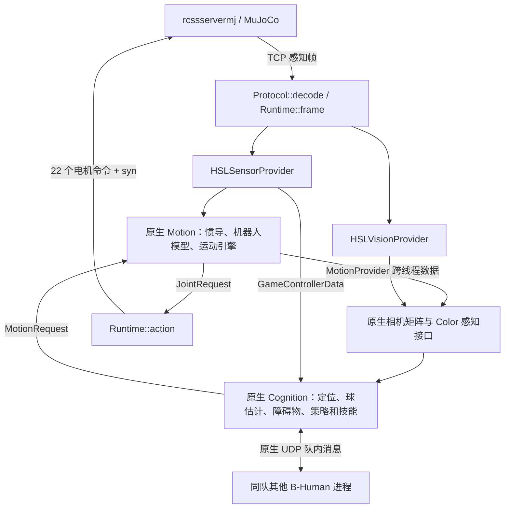

# B-Human 接入 rcssservermj：从原版框架到仿真闭环的教学说明

本文解释当前仓库**相对官方 B-Human Code Release 2026 增加和修改了什么、为什么需要这些改动、数据如何穿过整个系统**。适合已经会运行程序，希望继续阅读、调试或维护适配层的同学。

编译与比赛启动的简明操作见 [README_HSL.zh-CN.md](README_HSL.zh-CN.md)；服务器安装、裁判和键盘操作见相邻服务器的 [README](../dancer-rcssservermj/README.md)。本文重点讲实现原理，末尾给出用于学习的最小实验。

## 1. 先确定“原版”和分析范围

本文于 2026-10-21 核对以下本地 Git 版本：

| 对象 | 分支／提交 | 本文用途 |
|---|---|---|
| 官方基线 | 本地 `upstream/master`，`2e3374ba896da8288607f9a1881b876642fe18b8` | 官方 Code Release 2026 |
| 当前 B-Human 客户端 | `test/HSLServer`，`0f6b4510dbd8cc1a4faef6f1b0a7d464d978fe27` | 本文主要分析对象 |
| 配套服务器 | 相邻 `dancer-rcssservermj` 的 `ZJUDancer`，`a0828766f82764ef7f59b116252af9c38a6a9093` | 交叉核对协议、模型和物理控制 |

这里的 `rcssservermj` 指当前接入的 MuJoCo 仿真服务器；实际配套代码位于 `../dancer-rcssservermj`。工作区也有另一个 `../rcssservermj`，不能仅凭目录名认为二者具有相同的模型与扩展协议。

当前 HEAD 在官方基线上有三次提交：

| 提交 | 内容 |
|---|---|
| `e8e56d93c` | 新增 2026 HSL 接入层、配置、构建和诊断工具 |
| `c9467da89` | 调整忽略文件 |
| `0f6b4510d` | 增加 B-Human 自踢和 Large 场地 11v11 接入 |

相对上述官方基线，共有 **40 个文件变化：36 个新增、4 个修改，增加 3339 行、删除 4 行**，不含本文及其导航链接。旧的 `feature/rcssservermj-7v7`、其他远端分支和历史 2025 适配不在这组差异中。不要把它们的策略修改、监视器或踢球改造归到当前分支。

可以在仓库根目录复查：

```bash
git log --oneline 2e3374ba8..0f6b4510d
git diff --stat 2e3374ba8...0f6b4510d
git diff --name-status 2e3374ba8...0f6b4510d
git diff 2e3374ba8...0f6b4510d -- Src/Modules Src/Libs
```

本文对“未修改”的判断来自 Git 差异，对运行流程的解释来自源码；旧 README 中的历史联调成绩不视为本次重新测得的结果。

## 2. 核心设计：新增输入输出边界，继续运行原生模块

原版 2026 已经支持 K1，已经有神经网络行走、踢球、起身、定位、战术和队内通信。接入 rcssservermj 并不需要从零实现这些能力，需要解决的是：**原版模块怎样接收外部服务器数据，怎样按服务器时间运行，怎样把关节目标交回 MuJoCo。**

先认识四个 B-Human 概念：

| 概念 | 可怎样理解 | 本项目中的例子 |
|---|---|---|
| Representation | 带类型的数据接口 | `JointSensorData`、`BallPercept`、`RobotPose` |
| Module／Provider | 读入若干接口、计算并提供另一些接口的模块 | `SelfLocator` 提供 `RobotPose` |
| Blackboard | 每个线程保存和访问这些接口的数据区 | `Execution.cpp` 从中读取 `JointRequest` |
| ExecutionUnit | 控制一个线程何时执行一帧、执行前后做什么 | 新增的 `HSLFrame` |

`threads.cfg` 决定某个接口由哪个 Provider 产生。适配主要利用这个机制：把硬件和图像识别接口换成 HSL Provider，继续连接后面的原生算法。



这里的箭头表示数据依赖；实际帧顺序见第 5 节，Color 读到的运动学信息可以来自最近完成的 Motion 数据，并不表示 Motion 在本网络帧先运行。

### 2.1 哪些能力复用，哪些行为确实改变了

| 部分 | 当前处理方式 |
|---|---|
| 战术、技能和路径规划 | 继续使用原生 `StrategyBehaviorControl`、`SkillBehaviorControl`、路径与目标评估模块 |
| measured 定位 | 继续使用 `SelfLocator` 及原生特征注册、里程计 |
| 球和障碍物建模 | 注入 Percept，后续继续使用原生估计器／跟踪器 |
| 行走、踢球、起身 | 继续使用官方 K1 配置、ONNX 和原生运动模块 |
| 队内消息格式、收发与时间同步算法 | 继续使用原生实现，HSL 补上发送回调和共同 GC 时间参考 |
| 图像和硬件输入 | 新 Provider 替代相机、Booster 硬件及图像识别链路 |
| 帧调度 | 新增服务器驱动的 `HSLFrame`，默认每个网络帧执行十次 Motion |
| 开球／处罚时的运动请求 | 适配层显式覆盖为 `stand`，属于可观察的行为约束 |
| 无按钮启动 | 适配层主动激活 `GameStateProvider` |
| truth 定位 | 用服务器位姿替代 `RobotPose` 的原生定位输出 |

因此，“算法源码基本复用”不等于“运行行为与原版毫无差别”。输入来源、调度周期、默认接口值、视觉信息量及上述运动约束都发生了变化。

## 3. 改动落在哪些文件

### 3.1 仅有的四个原有文件修改

| 文件 | 改动 | 目的与影响 |
|---|---|---|
| [Make/CMake/CMakeLists.txt](Make/CMake/CMakeLists.txt) | 新增 `BUILD_HSL_SERVER` 选项及条件分支 | 构建无界面的客户端，避开 GUI、Python 绑定、ccache、mold 等要求 |
| [Src/Libs/Framework/Debug.h](Src/Libs/Framework/Debug.h) | 增加 `friend class HSLConsole` | 允许接入无界面的调试消息接收端 |
| [WalkingEngine.cpp](Src/Modules/MotionControl/WalkingEngine/WalkingEngine.cpp) | 宏保护的声明及两处推理后回调，共增加 11 行 | 记录实际运行的 walk／kick policy，不改网络输入输出和切换条件 |
| [.gitignore](.gitignore) | 忽略 `/build_sim`、`/build_monitor/`、`/logs/` | 避免提交本机构建与日志；忽略目录不代表本分支实现了对应工具 |

`BUILD_HSL_SERVER` 默认关闭；普通构建不启用 `BHUMAN_HSL_SERVER` 推理回调。

### 3.2 新增文件的职责

| 文件／目录 | 职责 |
|---|---|
| [Main.cpp](Src/Apps/HSLServer/Main.cpp) | 命令行入口、Settings、TCP 主循环、beam、CSV、退出清理 |
| [Protocol.h](Src/Apps/HSLServer/Protocol.h)、[Protocol.cpp](Src/Apps/HSLServer/Protocol.cpp) | TCP 分帧、S 表达式解析、协议数据结构与单位转换 |
| [Runtime.h](Src/Apps/HSLServer/Runtime.h)、[Runtime.cpp](Src/Apps/HSLServer/Runtime.cpp) | 共享帧与调度状态、参数校验、真值坐标变换、电机命令编码 |
| [Execution.cpp](Src/Apps/HSLServer/Execution.cpp) | `HSLFrame` 调度、调试请求、运动限制、队内消息发送、诊断采集 |
| [SensorProvider.h](Src/Apps/HSLServer/SensorProvider.h)、[SensorProvider.cpp](Src/Apps/HSLServer/SensorProvider.cpp) | 将关节、IMU、裁判等输入写成原生接口 |
| [IMUOrientation.h](Src/Apps/HSLServer/IMUOrientation.h) | 陀螺仪积分与三维倾斜校正 |
| [VisionProvider.h](Src/Apps/HSLServer/VisionProvider.h)、[VisionProvider.cpp](Src/Apps/HSLServer/VisionProvider.cpp) | 将对象极坐标转成球、交点、罚球点和机器人 Percept |
| [HSLMeasured/K1](Config/Scenarios/HSLMeasured/K1)、[HSLTruth/K1](Config/Scenarios/HSLTruth/K1) | 各有 `threads.cfg`、`perceptRegistrationProvider.cfg`、`logger.cfg` |
| `Config/Locations/HSL_hsl_{s,m,l,whrg}/` | 各有场地、球规格和入场位置，共 12 个文件 |
| [HSLServer.cmake](Make/CMake/HSLServer.cmake) | 新增 `run_player` 和两个测试目标 |
| [build_sim.sh](scripts/build_sim.sh)、[setup_sim_toolchain.py](scripts/setup_sim_toolchain.py) | 构建入口与本地 Clang 工具链准备 |
| [check_sim_kick.py](scripts/check_sim_kick.py) | 联合检查策略推理、真实脚球接触和球移动 |
| [ProtocolTest.cpp](Src/Apps/HSLServer/tests/ProtocolTest.cpp)、[IMUOrientationTest.cpp](Src/Apps/HSLServer/tests/IMUOrientationTest.cpp) | 协议与姿态积分测试 |
| [README_HSL.zh-CN.md](README_HSL.zh-CN.md) | 启动操作和历史联调记录 |

## 4. 入口与协议：一个球员对应一个客户端进程

### 4.1 Main 如何初始化原生框架

阅读 [Main.cpp](Src/Apps/HSLServer/Main.cpp) 的 `main()`，可按以下顺序理解：

1. 解析 `--field`、`--localization`、队名、队号、球员号等参数。
2. 定位资产目录并切换工作目录；执行 `FunctionList::execute()`，让原生模块和类型注册生效。
3. 初始化模拟时间，构造机器人类型为 `Settings::k1` 的 Settings。
4. 根据场地选择 `HSL_hsl_m` 等 Location，根据定位选择 `HSLMeasured` 或 `HSLTruth` Scenario。
5. 读取原生 `boosterProvider.cfg` 的关节映射与 `motorParameters.cfg` 的控制参数，读取 HSL 入场位置。
6. 连接服务器，发送 `(init K1BHuman TEAM NUMBER)`。
7. 收到第一份完整传感器帧后才创建 `Robot`，启动原生模块线程和 `HSLConsole`。

`SystemCall::getMode()` 在这个应用中返回 `simulatedRobot`。因此原生模块会采用模拟运行环境中的分支；这也解释了队内通信为什么走本机模拟通道。

机器人外部模型名是 `K1BHuman`，原生算法内部类型仍然是 `k1`，二者用途不同。

### 4.2 TCP 为什么要加长度头

TCP 是字节流，一次 `recv()` 不保证刚好读到一个完整消息。[Connection](Src/Apps/HSLServer/Protocol.cpp) 使用：

```text
[4 字节网络字节序无符号长度 N][N 字节 S 表达式文本]
```

`transfer()` 循环收发直到指定长度完成，并处理被信号中断的系统调用。连接设置 `TCP_NODELAY`，收发超时各 10 秒，接收消息上限 4 MiB。

一段文本可以连续包含多个表达式，例如：

```text
(time(now 1.24))
(GS(t 0.8)(pm KickOff_Right)(tl Home)(tr Away)(sl 0)(sr 0)(ko 1)(st 0))
(Pen(p 0)(s 0))
(HJ(n q_hj1)(ax 90)(vx -180)(tau 3.25))
(GYR(n torso)(rt 0 0 10))
(ACC(n torso)(a 0 0 9.81))
(pos(p -2 1 0.54))(quat(q 1 0 0 0))
(See(B(pol 2 0 -10))(L(pol 3 20 -8)))
```

这是便于阅读的字段示意，实际负载不要求这些换行。`parse()` 建立表达式树，`decode()` 再转换成 `hsl::Frame`。解析器拒绝括号不闭合、非法 token 和超过 32 层的嵌套；这里没有实现通用 Lisp 的求值和字符串系统。

### 4.3 各种字段进入哪里

| 服务器字段 | `Frame` 中的用途 | 后续接口 |
|---|---|---|
| `time(now ...)` | 全局模拟秒数 | 原生模拟时钟、`FrameInfo` |
| `GS` | 模式、比赛时间、队名、比分、开球队等 | 合成 `GameControllerData` |
| `Pen` | 本球员是否受罚、剩余秒数 | 本球员处罚状态 |
| `HJ` | 关节角、角速度、实际执行器力矩 | `JointSensorData` |
| `GYR`、`ACC` | 角速度与加速度 | `InertialSensorData` |
| `pos`、`quat` | 位姿、姿态 | truth 定位、倾斜角提取及诊断 |
| `See` 下普通对象 | 球、L/T/X、罚球点等极坐标 | 各类视觉 Percept |
| `See` 下带 `team` 的对象 | 球员及其可见部位 | `RobotPercept` |

同样名为 `P` 的对象可能是罚球点或球员。代码通过是否有 `team` 子项区分，避免将罚球点当作机器人。

`GS.st` 会被解析保存，但当前 GC 映射没有专门使用它。解析了某个字段，并不意味着全部下游逻辑已经使用它。

### 4.4 同步协议完成一帧

客户端先接收感知帧，等待原生模块处理完毕，然后把动作和 `(syn)` 放在同一条发送消息中。服务器没有提供有效 `time` 时，客户端只发 `(syn)` 继续握手。

典型动作负载是：

```text
(he1 ...)(he2 ...)...(rle6 ...)
(localization x_m y_m yaw_rad)
(syn)
```

`localization` 是客户端把估计结果报告给服务器，供显示／诊断使用；它不是服务器回传给定位器的测量。初始时还可能附加一次 `(beam x_m y_m yaw_deg)`。

主循环校验每帧有 22 条关节数据、存在四元数且每条关节数据有 `tau`。旧服务器即使能建立 TCP 连接，也可能因缺少扩展字段立即退出，错误为 `Server lacks HJ tau`。

## 5. 调度适配：20 ms 网络帧如何驱动原生线程

源代码：[Execution.cpp](Src/Apps/HSLServer/Execution.cpp) 的 `HSLFrame`，以及 [Main.cpp](Src/Apps/HSLServer/Main.cpp) 的主循环。

### 5.1 保留三个原生模块容器，替换帧源

HSL Scenario 保留 `Color`、`Cognition`、`Motion`，把它们的 executionUnit 全部设为 `HSLFrame`。原版的 Audio 线程没有启动，`Whistle` 作为默认接口存在，没有模拟麦克风识别哨声。

三个线程的 priority 都设为 0，不沿用原配置中 Cognition 的 1 和 Motion 的 20；各线程调试接收／发送／基础设施队列大小统一为 2800000／5200000／200000 字节。这些也是 HSL 线程配置相对原版的变化，实际帧执行顺序由下面的阶段屏障控制。

每个网络帧按下面的顺序放行：

```text
接收服务器帧 t
  → Color 执行一次
  → Cognition 执行一次
  → Motion 执行 N 次
  → 取最后一份 JointRequest
  → 发送电机动作和 syn
```

`Runtime` 的互斥量、条件变量、`stage`、`sequence` 和 `completed` 实现这道屏障。三个线程仍然存在，只是模块帧按阶段顺序放行；并没有把整个算法重写成一个单线程函数。

`beforeFrame()` 等待放行，`afterModules()` 收集结果，`afterFrame()` 推进阶段。主线程最多等待 15 秒，超时提示检查前面的模块依赖图错误。

### 5.2 十个 Motion 子帧的准确含义

默认 `--motion-subframes 10`，Settings 的 Motion 周期是：

```text
motionCycleTime = 0.02 / 10 = 0.002 s
```

子帧时间依次是 `t, t+2, …, t+18 ms`。`--motion-subframes 1` 时周期变成 20 ms；只接受 `1` 和 `10` 两种值。

| 层次 | 默认周期 | 发生的事情 |
|---|---:|---|
| 客户端网络帧 | 20 ms | 收一次感知、发一次最终目标 |
| Color／Cognition | 20 ms | 每个网络帧各执行一次 |
| 客户端 Motion 子帧 | 2 ms | 在同一份服务器数据上推进原生运动状态与计时 |
| 配套 MuJoCo 物理子步 | 5 ms | 服务器实际积分和电机控制 |

**十个子帧没有十份新传感器反馈，中间九份关节目标也没有逐个送到服务器。** 它改善了原生模块内部周期的匹配，但外部反馈仍是 50 Hz，不能称为真实 500 Hz 闭环，也不能保证和 SimRobot 的轨迹相同。

### 5.3 为什么统一时间，而不是读取本机墙钟

客户端使用：

```text
原生时间戳（ms） = 100000 + round(server_time × 1000)
```

`100000` 是避免初始零值的固定偏移。`FrameInfo` 使用线程局部的 `sensorTimestamp`；Motion 子帧同时推进原生模拟时钟，Color／Cognition 使用外层时间戳。

`--sim-speed` 则决定客户端按什么速度相对墙钟等待：模拟时间间隔除以该倍数。它不会把服务器物理步长变成另一数值，也不会单独突破服务器实时模式或其他同步客户端的速度限制。

### 5.4 没有胸口按钮和 GUI 怎么启动

`HSLFrame::beforeModules()` 在第一次 Cognition 执行时增加原生调试请求：

```text
module:GameStateProvider:active
```

这承担了普通模拟器激活球员的操作。适配层还调用 `SystemCall::mute(true)`，并通过 `HSLConsole` 将 `idText` 消息打印到标准错误；这不是完整的 SimRobot 控制台。

## 6. 传感器：把服务器量转换为 B-Human 接口

源代码：[SensorProvider.cpp](Src/Apps/HSLServer/SensorProvider.cpp)、[Runtime.cpp](Src/Apps/HSLServer/Runtime.cpp)。

### 6.1 第一原则是显式核对单位

| 量 | 服务器协议 | B-Human 内部 | 转换位置 |
|---|---|---|---|
| 关节角 `ax` | 度 | 弧度 | `Protocol::decode()` |
| 关节角速度 `vx` | 度／秒 | 弧度／秒 | `Protocol::decode()` |
| 陀螺仪 `GYR.rt` | 度／秒 | 弧度／秒 | `Protocol::decode()` |
| 加速度 `ACC.a` | m/s² | m/s² | 直接写入 |
| 关节 `tau` | Nm | Nm | 直接写入 `JointSensorData.torque` |
| 世界／视觉距离 | 米 | 通常为毫米 | `truth()`、`cameraPoint()` |
| 内部位姿航向 | 四元数／弧度 | 弧度 | `truth()` |
| 发回电机的目标角 | 内部弧度 | 协议度 | `Runtime::action()` |

例如 `(ax 90)(vx -180)(tau 3.25)` 转成 `π/2 rad`、`−π rad/s` 和 `3.25 Nm`。2026 的接口直接有 torque，当前代码没有把它伪装成电流。

### 6.2 22 个关节怎样对应

`sensorNames()` 和动作执行器数组按同一物理顺序排列，具体原生枚举从官方 [boosterProvider.cfg](Config/Robots/Default/K1/boosterProvider.cfg) 的 `jointMapping` 读取。

| 部位 | 传感器名 | 执行器名 | 官方映射顺序 |
|---|---|---|---|
| 头 | `q_hj1..2` | `he1..2` | yaw、pitch |
| 左臂 | `q_laj1..4` | `lae1..4` | shoulderPitch、shoulderRoll、elbowPitch、elbowYaw |
| 右臂 | `q_raj1..4` | `rae1..4` | 同左臂 |
| 左腿 | `q_llj1..6` | `lle1..6` | hipPitch、hipRoll、hipYaw、kneePitch、anklePitch、ankleRoll |
| 右腿 | `q_rlj1..6` | `rle1..6` | 同左腿 |

初始化要求映射长度是 22。`JointAnglesProvider` 等原生后处理仍然保留；适配层负责把原始关节测量填入对应位置。

### 6.3 没有真实硬件的接口如何处理

HSL Provider 将电池设为满电、温度设为 30、关节状态设为 regular；按键全部未按下，`DampingState.isDamping=false`，Joystick 更新为空操作，使用默认数据。

这些是仿真占位输入，不代表仿真具有电池、温度、手柄或急停硬件。音频检测和自动图像标定也没有通过 HSL 链路运行；相机标定参数从配置读取。

## 7. IMU：不使用绝对航向，但使用服务器倾斜角

源代码：[IMUOrientation.h](Src/Apps/HSLServer/IMUOrientation.h)、`Runtime::tilt()`、`HSLSensorProvider::update(InertialSensorData&)`。

这一部分最容易被“measured”这个名称误导。当前姿态输入包括：

1. 服务器陀螺仪和加速度计读数。
2. 服务器 `quat` 提取的重力相关 roll／pitch。
3. 用陀螺仪积分得到的相对航向，**不直接使用 quat 的场地绝对 yaw**。

`Runtime::tilt()` 归一化四元数，提取 roll／pitch 并将传出的 yaw 设为 0。`IMUOrientation` 用四元数保存积分状态：

```text
q ← q × Quaternion(gyro 方向, |gyro| × dt)
由测得倾斜角求机体中的竖直方向
求把该方向对齐世界竖直方向的最短三维旋转
校正 q 并归一化
最后提取提供给原生接口的欧拉角
```

为什么要这样做？机器人翻倒时 pitch 可能经过 ±90°，直接在欧拉角上积分 yaw 容易出现奇异误差；内部保存四元数可以跨越这些姿态。仅靠重力方向无法恢复场地绝对航向，初始航向参考为局部参考，之后依靠 gyro 和原生定位链路处理。

本适配的倾斜校正不是从加速度自行估计出来的，而是使用了服务器姿态。加速度仍提供给后面的原生 `InertialDataProvider` 等模块。

因此，当前 measured 模式可以准确描述为：**不直接使用世界 x/y/yaw 进行自定位，但带有服务器提供的理想倾斜参考**。如果教学或研究要求完全不依赖姿态真值，需要另行替换这一输入；当前实现尚未达到这个条件。

## 8. 视觉：替换识别输出，保留后续估计

源代码：[VisionProvider.cpp](Src/Apps/HSLServer/VisionProvider.cpp) 和 [HSLMeasured 线程配置](Config/Scenarios/HSLMeasured/K1/threads.cfg)。

### 8.1 从哪一层接入

原版 Color 线程包含相机读取、图像预处理、线与球识别、球衣识别等模块。服务器已经提供可见对象的距离和角度，所以 HSL 移除了这些图像处理 Provider，直接生成原生 Percept。

仍然保留的关键模块包括 `RobotCameraMatrixProvider`、`CameraMatrixProvider`、`BodyContourProvider`、`MeasurementCovarianceProvider`，以及来自 Motion 的 `JointAngles`、`RobotModel`、`TorsoMatrix` 和 `OdometryData`。

相机接口固定为 `544×448`、光心 `(272,224)`、水平／垂直视场角 `105°×94°`，与 `K1BHuman` 模型一致。没有传输真实 RGB 图像，因此不能用这个接入方式评价原版图像检测器的精度和耗时。

### 8.2 极坐标先变成相机三维坐标

服务器提供距离 `r`、方位角 `a`、仰角 `e`，距离用米、角度用度。先转为毫米和弧度：

```text
x_camera = 1000r × cos(e) × cos(a)
y_camera = 1000r × cos(e) × sin(a)
z_camera = 1000r × sin(e)
p_relative = CameraMatrix × [x_camera, y_camera, z_camera]
```

最后取二维平面位置。这里的 `CameraMatrix` 是原生运动学链计算出来的，不使用服务器世界 x/y/yaw。

例如 `r=2 m, a=0°, e=0°` 时，相机坐标是 `(2000,0,0) mm`；变换后还包含相机的位置、朝向与机体倾斜，不能直接将 `(2000,0)` 当作最终球位置。

尽管字段叫 `positionOnField`，这里表达的是机器人附近的场地平面坐标；它不是由服务器直接提供的世界绝对坐标。`SelfLocator` 之后才将地标与场地地图关联。

### 8.3 不同对象如何写成 Percept

| 观测 | 写入方式 | 后续仍由原版完成的事情 |
|---|---|---|
| 球 `B` | 选最近的正距离球；写相对位置、协方差、球半径和投影图像位置 | 球观测过滤、球状态估计、队伍球模型 |
| `L/T/X` | 写交点类别、位置、协方差 | 地标关联、定位假设更新 |
| 罚球点 `P` | 选近处罚球点，写位置和协方差 | 罚球点注册与定位 |
| 机器人 | 用第一个可见部位作为中心，区分己方／敌方 | 障碍物融合、全局对手和队友跟踪 |

位置协方差采用简单的各向同性近似：

```text
σ = 20 mm + 0.015 × 平面距离（mm）
Σ = σ² I
```

例如距离 2000 mm 时，σ 为 50 mm。这是适配器为原生估计器提供的不确定度模型，不是完整传播服务器噪声得到的协方差。

球的图像位置和半径由极坐标反投影构造，属于兼容接口所需的几何量，不是实际图像检测结果。

### 8.4 缺失的信息明确置空

服务器未提供原生定位所需的完整线段和交点方向，因此：

- `FieldLines`、`LinesPercept` 清空。
- `CirclePercept.wasSeen=false`，`FieldBoundary.isValid=false`。
- 交点的 `dir1`、`dir2` 设为零，并在两个 HSL Scenario 中配置 `useIntersectionDirections=false`。

后一项配置必须与代码配套。零向量并不是“方向刚好为零”，而是此项测量不存在，不能让注册模块把它当成有效几何约束。

此外 HSL 配置将交点最大偏差设为 500 mm、罚球点最大偏差设为 750 mm。它们影响观测与地图候选的关联容忍度，不是在修改 SelfLocator 算法。

### 8.5 障碍物存在几何近似

`RobotPercept` 将第一个可见部位投影作为中心，在与视线垂直的方向各扩展 180 mm，形成总宽约 360 mm 的障碍物。没有从深度图恢复人体轮廓，也没有融合所有身体部位。

当前配套服务器在 `See` 球员对象中使用 `"0"`／`"1"` 队侧标识；Provider 据此区分己方、敌方并排除自己，不能把这里的 `player.team` 和 `GS` 中的显示队名混为一谈。改服务器输出身份格式时必须一起检查这一段。

## 9. truth 与 measured：只切换定位输出

两份 `threads.cfg` 的唯一差异是：

```text
HSLMeasured: RobotPose ← SelfLocator
HSLTruth:    RobotPose ← HSLSensorProvider
```

两份 `perceptRegistrationProvider.cfg` 和 `logger.cfg` 相同。truth 模式仍使用相同的球和机器人观测、原生行为、球估计及运动模块；**truth 不会将全部视觉替换为无噪声世界真值**。

### 9.1 measured 的数据路径

```text
服务器 See 测量
 → HSLVisionProvider
 → 原生 PerceptRegistrationProvider
 → 原生 SelfLocator
 ← 原生 MotionEngine / OdometryDataPreviewProvider 的里程计
 → RobotPose
```

`SelfLocator` 保留原版的采样假设和 UKF 更新机制，既不是在 HSL 中另写定位器，也不是将服务器位置包装成“测量”。`GroundTruthRobotPose` 只是默认接口，HSL 没有向其注入每帧世界真值。

### 9.2 truth 为什么要按左右队变换

服务器世界坐标对全场共用，B-Human 希望自己的进攻方向始终为 +x。`Runtime::truth()` 从 `(w,x,y,z)` 四元数提取 yaw，然后：

```text
左队：p_team = 1000 × p_world，yaw_team = yaw_world
右队：p_team = −1000 × p_world，yaw_team = normalize(yaw_world + π)
```

右队变换相当于绕场心旋转 180°，不是仅将 x 镜像。举例：右队世界位姿 `(2 m, −1 m, π)` 对应己方坐标 `(-2000 mm,1000 mm,0)`。

左右队从 `GS.tl/tr` 与本进程队名匹配得出，一旦确定便保留。当前实现没有完整的中场换边流程，不能据此推断已经支持动态交换左右半场。

truth Provider 将位置质量设为 `superb`。CSV 即使在 measured 模式也会写真值列用于误差分析；记录真值与将真值输入定位是两个不同操作。

## 10. 裁判适配：把 play mode 转成原生 GameControllerData

源代码：`HSLSensorProvider::update(GameControllerData&)`，位于 [SensorProvider.cpp](Src/Apps/HSLServer/SensorProvider.cpp)。

本应用不启动真实 UDP GameController 接收器，而是每帧用服务器信息合成原生数据结构。后面的 `GameStateProvider`、`ExtendedGameStateProvider`、行为模块继续工作。

### 10.1 模式映射

| 服务器模式 | 原生映射 |
|---|---|
| `Initial`、`BeforeKickOff`、空模式 | `STATE_INITIAL` |
| `Ready*`、`Goal_*` | `STATE_READY` |
| `GameOver`、`Finished`、`HalfTime` | `STATE_FINISHED` |
| 其他，包括 `KickOff*`、`PlayOn` | `STATE_PLAYING`，再结合开球队和定位球类型 |
| `goal_kick*` | `SET_PLAY_GOAL_KICK` |
| `corner_kick*` | `SET_PLAY_CORNER_KICK` |
| `KickIn*` | `SET_PLAY_THROW_IN` |
| `penalty_kick*`、`penalty_shoot*` | `SET_PLAY_PENALTY_KICK` |
| 包含 `free_kick`、或 `offside*` | `SET_PLAY_INDIRECT_FREE_KICK` |

其他合成字段包括本队人数、左右队比分、1 号门将、本球员处罚、队伍消息预算。未上场号码标记为替补。

这里是有意简化的协议转换：`gamePhase` 固定 normal、`firstHalf=1`，剩余时间按 `600−playTime` 截断；对手队号按本队号是否为 1 选择 2 或 1。标准启动器给双方分配 1／2 队号，与这组假设相符。任意比赛时长、真实点球大战阶段或任意对手队号并非都已完整建模。

### 10.2 不开球方为什么会站住

适配分为两部分：

1. Sensor Provider 记录 KickOff 起始时刻和开球队，在 `KickOff*` 以及随后 `PlayOn` 的窗口内设置最多 10 秒的 `secondaryTime`，让原生 GameStateProvider 继续进行对手开球及球运动判断。
2. `HSLFrame::beforeModules()` 在每个 Motion 子帧检查服务器对手开球状态、原生 `opponentKickOff` 状态以及处罚状态，满足任一条件就把 `MotionRequest.motion` 设为 `stand`。

这样，即使服务器刚切到 `PlayOn`，原生对手开球等待仍可继续生效。最终放行取决于服务器模式和原生状态转换；适配器没有单独写一个“球位移大于某值”的检测器。

这是实质性的运动请求覆盖，不应写成“完全没有改变行为”。`--test-cmd` 和 `--test-stand` 也先于这道限制执行，因此运动诊断参数不会绕开开球与受罚站立限制。

### 10.3 罚停为什么影响定位恢复

`Pen(p 1)(s ...)` 映射为本球员 `PENALTY_ILLEGAL_POSITIONING` 及剩余秒数，具体不同处罚原因没有逐一细分。

原生 [ExtendedGameStateProvider](Src/Modules/Infrastructure/GameStateProvider/ExtendedGameStateProvider.cpp) 判断解除处罚后是否应重置定位：默认正常门槛 23 秒，提前结束处罚的门槛 12 秒，比较是严格大于。配套服务器默认罚停 15 秒，可以走超过 12 秒的分支；旧的 10 秒罚停不满足该门槛。

原生 [SelfLocator](Src/Modules/Modeling/SelfLocator/SelfLocator.cpp) 随后据 `returnFromGameControllerPenalty` 将样本重置到场边入场假设。客户端没有在受罚瞬移时将真实位置直接灌入 measured 定位器；应观察解除处罚后的重置和视觉收敛。

## 11. 队内通信：仍走原生 UDP，需要补齐时钟与发送时机

### 11.1 这里没有把队内消息改为服务器 say/hear

[TeamMessageHandler](Src/Modules/Communication/TeamMessageHandler/TeamMessageHandler.cpp) 在非 `TARGET_ROBOT` 构建中调用原生 `TeamMessageChannel::startLocal()`；[Settings](Src/Libs/Framework/Settings.h) 给出端口：

```text
UDP 端口 = 10000 + team-id
```

本机模拟通道使用 UDP 组播，允许本机回环，TTL 为 0。`team-id=1`／`2` 通常分别使用 10001／10002，球员号用于标识本机球员。

同队进程必须使用同一 `team-id` 和不同球员号；两队必须分开 team-id。**将 agent TCP 的 `--host` 指向远程服务器，不会自动让这种本地队内通道跨机器工作。** 分布式部署需要另外设计通信，不属于当前适配范围。

也不要据此认为 B-Human 与 dancer-robocupdemo 的队友消息天然兼容；双方可以同场对踢，不代表内部消息协议相同。

### 11.2 为什么“收到 UDP”仍可能没有队友

原生 [GameControllerRBS](Src/Tools/Communication/GameControllerRBS.cpp) 利用共同 GC 包来做时钟同步。如果每个球员按自己的启动时间生成包号，同样包号就不再指同一个参考事件；原生逻辑可能丢弃未同步消息。

HSL 用服务器共同时间构造约 2 Hz 的虚拟广播参考：

```text
gcTick = floor(server_time × 2)
packetNumber = uint8(gcTick)
timeLastPacketReceived = 100000 + gcTick × 500 ms
```

这使晚启动的同队进程也能得到一致的包号与时间定义。它是客户端合成的共同参考，不是真正收到了一份外部 GC UDP 包。

### 11.3 新执行器还必须主动发送

`HSLFrame::afterModules()` 在 Cognition 阶段获取 `BHumanMessageOutputGenerator`，在原生 `sendThisFrame()` 判断允许时调用 `send()`。仅在配置中保留 TeamMessageHandler 还不足以保证新执行入口真的把队伍消息发出去。

同时采集：

| CSV 字段 | 含义 |
|---|---|
| `teammates` | 当前原生 TeamData 中的队友条目数 |
| `team_sent` | 累计发送消息数 |
| `team_received` | 累计接收消息数 |
| `team_unsynchronized` | 累计收到的未同步消息计数 |

诊断时要将收发计数、未同步计数和队友数一起看。自启动以来没有未同步消息，并不单独证明所有应有队友都在通信；Ready／PlayOn 中仍需确认预期人数。

## 12. 电机输出：原生 JointRequest 怎样成为服务器 PD 命令

源代码：[Runtime.cpp](Src/Apps/HSLServer/Runtime.cpp) 的 `Runtime::action()`，配置来自官方 [motorParameters.cfg](Config/Robots/Default/K1/motorParameters.cfg)。

### 12.1 发送的不是走路速度，而是关节目标

原生行为给出 `MotionRequest`，原生运动引擎产生 `JointRequest`。HSL 不把“向前走 1 m/s”直接交给服务器运动学移动机器人，而是逐个编码 22 个电机：

```text
(执行器名 目标角_deg 目标角速度_deg/s kp kd 前馈力矩_Nm maxTorque_Nm)
```

当前输出的目标角速度和前馈力矩都为 0，位置目标来自原生运动引擎。动作示意：

```text
(lle4 30 0 100 2 0 40)
```

该示意只说明字段位置，不代表真实膝关节配置值。

### 12.2 刚度、标定和增益的关系

对每个关节：

```text
s = clamp(stiffness_percent / 100, 0, 1)
若目标为 off 或 ignore，则 s = 0
q_target = s > 0 ? 原生目标 + calibration_offset : 当前测得 JointAngles
kp_send = 原生所选 p × s
kd_send = 原生所选 d × s
maxTorque_send = 原生所选 maxTorque
```

参数组由 `JointRequest.jointStiffnessMapping` 选择，可使用原生 regular／low 配置。刚度同时缩放 p 和 d；这里并没有按刚度比例缩放 `maxTorque`。

### 12.3 为什么还需要服务器配合

仅发送相同 kp／kd 不保证不同物理引擎产生相同响应。配套服务器新增了 [simrobot_motors.py](../dancer-rcssservermj/src/rcsssmj/sim/simrobot_motors.py)，对有 `simrobot_servo_*` 元数据的模型执行：

1. 按关节限位截断目标角。
2. 每个物理子步对关节速度低通。
3. 计算位置 P、速度 D 和前馈力矩之和。
4. 根据客户端 `maxTorque` 动态限幅。
5. 再由 MuJoCo 执行器 XML 的固定 `ctrlrange` 限幅。

公式为：

```text
v_filtered ← v_filtered + α(v_measured − v_filtered)
τ = kp(q_target − q_measured) + kd(v_target − v_filtered) + τ_ff
τ_dynamic = clip(τ, −maxTorque, maxTorque)
```

原生 SimRobot 参考低通系数是 2 ms 下的 0.22。5 ms 物理步长使用：

```text
α = 1 − (1 − 0.22)^(5/2) ≈ 0.4626756689
```

这保留滤波的时间常数，不代表物理闭环变成 2 ms。服务器还禁用这组电机原有的 position／velocity 执行器增益，避免 PD 施力重复计算。

可选 `maxTorque` 是旧六参数动作后新增的第七个数值。旧命令不传此项时保留当前动态上限，首次取模型默认值；动态上限不能突破 XML 固定上限。其他机器人加入引发模型重编译时，服务器保存已有命令和低通状态；退出重连则重新初始化。

这些是**服务端适配**，不在 B-Human 的 40 个差异文件里；只更新客户端而未更新服务器，无法获得这套闭环。

## 13. 模型、场地和出生位置也属于接口契约

### 13.1 K1 支持来自原版，K1BHuman 是服务器模型名

服务器已有的 `K1` 与官方 K1 在相机、初始姿态及动力学细节上不能直接视作相同。因此客户端初始化选择 `K1BHuman`，服务端使用从官方 [K1.rsi3](Config/Scenes/Includes/K1/K1.rsi3) 转换的独立模型。

详细转换依据见服务器的 [K1BHuman 模型说明](../dancer-rcssservermj/src/rcsssmj/resources/robots/K1BHuman/README.md) 和 [导入脚本](../dancer-rcssservermj/tools/import_bhuman_k1.py)。它保留 22 个关节、完整刚体惯量、质心、碰撞体、限位与各关节转子惯量；总质量 19.666 kg。出生／beam 高度取官方场景的 537 mm，相机头部位置为 `(0.0601,0.0351,0.0928) m`。

这不是在 B-Human 仓库里训练了新机器人，也不表示两个物理引擎数值等价。转换后的 MJCF、STL 和控制实现存放在服务器仓库，运行时服务器不需要读取 B-Human 源仓库。

### 13.2 四种 Location 与球规格

| 客户端 `--field` | 服务器 `--field` | 名义场地尺寸 | 客户端默认球半径／质量 |
|---|---|---|---|
| `hsl_s` | `hsl_s_26` | 9×6 m | 70 mm／0.16 kg |
| `hsl_m` | `hsl_m_26` | 14×9 m | 95 mm／0.295 kg |
| `hsl_l` | `hsl_l_26` | 22×14 m | 110 mm／0.41 kg |
| `hsl_whrg` | `hsl_whrg_26` | 22×14 m | 95 mm／0.295 kg |

对应目录：[Small](Config/Locations/HSL_hsl_s)、[Middle](Config/Locations/HSL_hsl_m)、[Large](Config/Locations/HSL_hsl_l)、[WHRG](Config/Locations/HSL_hsl_whrg)。

这些文件采用 2026 `FieldDimensions` schema，包括线段、L/T/X 候选点、球门、角弧、罚球点及罚后入场位置。没有仅改一个“场长”常量。

名义尺寸与线中心坐标不同。例如 Middle 长 14 m、线宽 50 mm，客户端对方底线使用 `x=6975 mm`，边线 `y=4475 mm`；中圈线中心半径为 1475 mm。直接写成 7000／4500／1500，会让定位地图和服务器产生的特征点有系统偏差。

球配置的 `staticFriction=-0.30` 是原生球运动模型参数，不可直接当成 MuJoCo 接触摩擦系数。配套服务器还对 3 号球、Middle／Large 地面做了物理参数对齐，具体值和作用范围以其 README 及实现为准。

服务器 `--ball-size` 可以覆盖默认球，但本客户端没有对应的自动协商。如果在 Large 场地将服务器改为 3 号球，客户端仍读取 Large 的 110 mm／0.41 kg，需同时提供匹配的客户端球配置；否则会影响球半径、踢球速度和距离估计。

### 13.3 初始 beam 来自配置

`setupPosesProvider.cfg` 给每个号码提供位置和朝向目标。主循环在收到 `Initial` 且尚未 beam 时发一次 beam；默认从配置毫米转为米，从朝向目标计算角度并转为度。

`--beam-x` 或 `--beam-y` 会启用显式位置，配合 `--beam-theta` 使用；单独设置 theta 不会使 `beamExplicit` 生效。未显式指定的坐标参数保持默认 0，因此手工实验应将三者一起写全。

这是初始放置，不是每帧强制锁定机器人。客户端启动时会检查 1 到 `num-players` 的每个入场位置是否存在，即使当前只运行其中一名球员也会检查完整声明人数。

## 14. 11v11：启用原版策略，没有重写阵型算法

源代码：[Main.cpp](Src/Apps/HSLServer/Main.cpp)、[Runtime.cpp](Src/Apps/HSLServer/Runtime.cpp)、[Large 入场配置](Config/Locations/HSL_hsl_l/setupPosesProvider.cfg)。

参数约束：

- `hsl_l` 允许每队 1–11 人，其他场地允许 1–7 人。
- 球员号必须在 `1..num-players` 中，1 号是门将。
- 当人数大于 7 时，将原生 `Config/Scenarios/11v11/` 插入配置搜索路径最前面。

官方 [11v11 Scenario](Config/Scenarios/11v11/strategyBehaviorControl.cfg) 仅指定 `strategy=s11v11`；其余线程和 HSL 定位、场地、运动配置继续按原搜索路径加载。原版 [s11v11.cfg](Config/Behavior/Strategies/s11v11.cfg) 选择 `t343` 及 11v11 定位球，形成门将加 3 后卫、4 中场、3 前锋。

人数不超过 7 时保留默认 `s5v5` 及其人数自适应逻辑；7 人不会自动选择一个另写的 7v7 阵型。`--role striker` 也只是命令行对场上球员身份的校验，实际进攻／防守角色由原生策略动态分配。

Large 的入场文件为 8–11 号补充了下边线外的独立位置。新增日志字段 `tactic`、`position`、`role`，记录原生 `StrategyStatus`，可以核对实际接受的战术，而不是只看启动参数。

原生配置搜索机制位于 [Settings.cpp](Src/Libs/Framework/Settings.cpp)：机器人专属、Location、Scenario、默认机器人类型和默认配置逐层回退。HSL 只新增覆盖文件，没有复制整套原生配置。

## 15. 行走和踢球：网络来自原版，新增的是可观测性

官方 [walkingEngine.cfg](Config/Robots/Default/K1/walkingEngine.cfg) 已指定：

| 功能 | 原生模型 | 关键点 |
|---|---|---|
| 行走／站立 | `Config/NeuralNets/Walk/K1_walk.onnx` | 行走输入 344 维 |
| 普通动态踢／强踢 | `Config/NeuralNets/Walk/K1_kick_inner.onnx` | 踢球输入 59 维，原版内部区分踢球请求 |
| 旧动态踢 | `Config/NeuralNets/Walk/K1_kick_inner_soft.onnx` | 原生 old ball policy |
| 起身 | `Config/NeuralNets/GetUpEngine/` | 原生 GetUpEngine |
| 里程计预测 | 原生 K1 odometry 模型及配置 | 原生 OdometryDataPreviewProvider |

模型推理在客户端内进行，不需要另外启动 Isaac Gym 或训练仓库。当前分支没有修改 `Config/NeuralNets`、原生策略文件、SelfLocator、TeamMessageHandler 或 GetUpEngine 源码。

### 15.1 原生切换仍然检查运动上下文

在 `WalkPhase::getNextTargetRequest()` 中，原版根据请求类型、球观测新鲜度、球距离及滞回、路径避障、拦球等条件决定运行 walk policy 还是 ball policy。HSL 没有把条件简化成“只要看见球就踢”。

强踢与普通踢并不一定对应两个不同文件；原版会在相同踢球模型的观测里设置强踢等特征。只看文件名不足以解释全部行为。

### 15.2 为什么新增推理回调

原版 WalkingEngine 的 `WalkPhase::calcJoints()` 将 `isWalkPhaseInWalkKick=false`，而 `MotionInfo::isKicking()` 依赖这个标志。因此当前 RL 踢球可能仍处于 walk 阶段，`kicking` 列也不能可靠表示是否刚调用了踢球网络。

适配在 walk／kick 的 `policy.apply()` 之后分别增加宏保护回调：

```cpp
#ifdef BHUMAN_HSL_SERVER
bhumanHSLPolicyInference("K1_walk.onnx");
#endif
```

kick 分支记录实际使用的普通或旧模型。回调更新最近模型名、推理时间和累计次数；不改变 policy 的输入、输出、频率和动作选择。

但 **kick 推理次数不等于踢球次数，更不等于进球或有效触球次数**。一次接近球的动作可能连续执行很多次网络推理，需要结合真实物理接触判断。

## 16. 编译适配与容易漏装的资产

### 16.1 HSL 构建具体绕开了什么

`BUILD_HSL_SERVER=ON` 设置 `MINIMAL_PROJECT`，使用桌面侧原生核心库创建无界面的 `run_player`。这不构建 SimRobot GUI，也不走 Booster 硬件交叉编译入口。

新增条件跳过 Python 绑定、Linux ccache 编译启动器和 mold 链接选项。`HSLServer.cmake` 将 `run_player` 链接到原生 `B-Human` 库；`HSL_ASSETS_DIR` 将源码根目录作为默认资产路径，运行时也可以用 `--assets-dir` 指向另一份完整资产。

因此 `run_player` 并非只复制一个二进制就能独立运行，它仍需要配置和神经网络文件。默认资产路径还与构建时源码位置有关，移动整个仓库后应检查路径。

### 16.2 构建脚本做了哪些准备

`scripts/build_sim.sh` 会：

1. 初始化并更新锁定版本的 `Util/SimRobot`、`Util/CompiledNN` 子模块。
2. 调用官方 `Make/Common/pullONNXRuntime`，下载本版要求的 ONNX Runtime 1.22.0。
3. 选择本地 `.hsl-toolchain/bin/clang++`，或 `HSL_CXX_COMPILER` 指定的编译器。
4. 若缓存编译器路径变化，移除对应 CMake 缓存和生成目录后重新配置。
5. 在 `build_sim/` 生成 Release 构建，默认用 4 个并行任务构建 `run_player`。

SimRobot GUI 虽不参与构建，其子模块仍提供 Eigen 等依赖，不能省略子模块初始化。

工具链准备脚本面向 Linux x86_64，下载固定 Clang 18.1.8 及依赖包，核对 SHA256 后解包到 `.hsl-toolchain`，不要求把 Clang 安装到系统目录。执行该脚本的 Python 环境需要 `zstandard`；其他平台需要另行提供合适工具链。协议代码使用 POSIX socket 接口，当前实现不能直接视作已移植到 Windows。

### 16.3 哪些东西不随普通 Git 文件一起到来

| 资产 | 获取方式 | 忽略／依赖关系 |
|---|---|---|
| `.hsl-toolchain/` | `setup_sim_toolchain.py` | 被现有隐藏文件通配规则忽略 |
| `Util/onnxruntime/lib/` | 官方下载脚本，由 build_sim 调用 | 原有 `.gitignore` 明确忽略 |
| `Util/SimRobot`、`Util/CompiledNN` 内容 | Git 子模块初始化 | 是锁定的外部仓库内容，不是普通目录拷贝 |
| `build_sim/` | 本机编译 | 本分支新增忽略 |
| 服务器 Python 环境和依赖 | 按服务器 README 安装 | 不由本客户端构建脚本安装 |

这解释了“源代码能 clone 成功，首次编译／运行仍缺库”的常见情况。无需为了写客户端文档重复整套服务器安装步骤，但首次使用必须完成这些准备。

## 17. 诊断与教学实验

### 17.1 CSV 是当前接入层的主要观察窗口

`--trace FILE` 显式指定 CSV；未指定时，可以设置 `HSL_TRACE_DIR`，自动生成 `TEAM_NUMBER.csv`。显式路径优先，`--trace` 的父目录需要自行创建；自动 trace 目录由程序创建。

| 字段组 | 代表字段 | 用途／单位 |
|---|---|---|
| 服务器状态 | `time`、`mode`、`penalized`、`height` | 秒、模式、处罚、躯干高度（米） |
| 定位 | `truth_x/y/yaw`、`estimate_x/y/yaw`、`pose_quality` | 平面位置毫米，角度弧度；真值已转为己方坐标 |
| 里程计 | `odom_*`、`cog_odom_*` | Motion 与 Cognition 侧里程计，可观察跨线程时序 |
| 运动 | `motion`、`phase`、`phase_started`、`motion_ticks` | 原生请求、阶段及累计子帧 |
| 球 | `ball_age`、`ball_x/y` | 观测年龄秒、机器人相对球位置毫米 |
| 姿态 | `imu_yaw`、`native_yaw`、`gyro_z` | 适配输入航向、原生惯导航向、陀螺仪 rad/s |
| policy | `policy`、`walk_inferences`、`kick_inferences`、`policy_time` | 最近模型、累计推理、原生毫秒时间戳 |
| 裁判／通信 | `gc_*`、`team_*`、`teammates` | 检查状态、共同时间参考和队友通信 |
| 战术 | `tactic`、`position`、`role` | 原生接受的战术、位置及行为角色 |

部分枚举以整数写入 CSV，需要参照原生枚举定义；终端每 100 帧输出的运动和阶段则包含枚举名。`policy` 表示最近一次推理，可能在两次推理之间保留旧值，要结合 `policy_time` 和计数增量阅读。

HSL `logger.cfg` 将原生日志关闭，`HSLFrame::initLogging()` 也不返回原生日志控制器。因此当前主要使用这里单独实现的 CSV；不能只看到 logger 文件中的 representation 清单，就认为已经记录了完整原生日志或图像。

### 17.2 实验一：先确认协议和姿态适配

在 B-Human 仓库根目录，完成工具链准备后执行：

```bash
bash scripts/build_sim.sh
cmake --build build_sim --target hsl_protocol_test hsl_imu_test -j4
ctest --test-dir build_sim --output-on-failure
build_sim/run_player --help
```

两个测试分别验证：

- `hsl_protocol`：状态／罚停／力矩解析、角度换算、P 对象身份区分、旧包不虚构 torque、畸形表达式拒绝。
- `hsl_imu`：伴随转向的前／侧翻完整姿态积分，以及相同重力方向不应泄露绝对场地航向。

它们不是比赛测试，不能证明定位精度、所有关节顺序、通信或长时间稳定性都正确。

### 17.3 实验二：跟踪一名球员的完整闭环

先在服务器终端启动匹配的 Middle 场地，具体安装方法见服务器 README：

```bash
cd /home/robotics/ZJUDancer/dancer-rcssservermj
.venv/bin/rcssservermj --host 127.0.0.1 --aport 60000 --mport 60001 \
  --field hsl_m_26 --sync --render
```

再在客户端终端运行：

```bash
cd /home/robotics/ZJUDancer/BHumanCodeRelease
mkdir -p /tmp/bhuman-adaptation-lesson
build_sim/run_player --host 127.0.0.1 --port 60000 \
  --team LessonA --team-id 1 --num 3 --num-players 3 \
  --field hsl_m --localization measured \
  --trace /tmp/bhuman-adaptation-lesson/player3.csv --max-frames 1000
```

这里只启动 3 号一个进程，`--num-players 3` 声明队伍规模，并不会自动启动另外两人。按服务器操作触发 Ready／开球，观察 `mode`、`game_state`、`motion`、`phase` 和 `policy` 的关系。

重新启动一轮相同实验，将 `--localization measured` 改为 `truth` 并换一个日志文件名；比较实际误差，不要期待存在随机视觉和物理过程的两次运行逐帧相同。再用 `--motion-subframes 1` 做周期对照，确认这改变的是内部运动调度。

### 17.4 实验三：验证自踢中的队友与战术

完整的 3v3／11v11 启动命令见操作 README。使用相邻统一入口时显式传：

```text
--home-repo /home/robotics/ZJUDancer/BHumanCodeRelease
--localization measured
```

不传 `--guest-repo` 时两队复用 home 客户端；需要不同队名。`HSL_TRACE_DIR` 可以传递到各个子进程，按队名和号码分文件记录。

当前相邻 `start_sim_game.sh` 的默认 localization 是 truth，而 `run_player` 默认是 measured，因此教学实验应显式指定，避免把启动入口差异误当成定位器表现。它还会传递 `--role striker` 给所有非门将，这是身份标记，不是强制每名球员抢球。

不要给 B-Human 客户端添加该入口中面向其他客户端的 `--student`、`--motion-log-dir` 参数；当前 B-Human 参数解析不接受最终透传的 `--student`／`--motion-log`。

11v11 中先核对 `tactic=t343` 和预期队友数 10，再观察具体角色；不要只依据 22 个进程是否存活判断协作成功。

### 17.5 实验四：什么才算验证真的踢到球

```bash
python3 scripts/check_sim_kick.py
```

脚本默认使用相邻服务器虚拟环境、60220／60221 TCP 端口、队号 97 的 UDP 端口 10097，启动一个采用原生行为和 truth 定位的 3 号球员，输出到新建的 `/tmp/bhuman2026-kick-*` 目录。

它做三层检查：

1. `kick_inferences` 增量确认实际运行了踢球 policy。
2. 包装服务器 `mujoco.mj_step`，记录真正的脚部几何与球接触，匹配推理事件附近的物理采样。
3. 检查接触后 0.5 秒内球的连续平面位移，并排除裁判重新摆球导致的突跳。

判据要求有匹配接触且最大连续位移至少 0.1 m。接触数量是物理采样数，不能当作独立踢球次数；脚本也不评价落点精度、比赛胜率或 measured 定位性能。

脚本会探测两 TCP 端口是否空闲，结束时清理自己启动的进程。它需要已经编译的 `run_player`、可用的服务器 Python 环境及上述服务端扩展。

## 18. 排错时沿哪条链查

| 现象 | 优先核查 |
|---|---|
| 连接成功后立即报 `HJ tau` 缺失 | 是否启动更新后的配套服务器，而不是另一目录／全局安装版本 |
| `Incomplete K1 sensor frame` | 是否选择 `K1BHuman`、四元数和 22 个关节是否完整 |
| 模块帧 15 秒超时 | 先读更早的模块图错误，检查 Scenario、默认接口和配置搜索路径 |
| 球位置总有倍率错误 | 极坐标米→毫米、角度度→弧度是否只转换一次 |
| 机器人始终在对手开球时不动 | 查服务器模式、原生 opponentKickOff、secondaryTime 和处罚状态 |
| 多人已运行但队友数为 0 | 查同队 team-id、不同球员号、本地组播、发送回调和 RBS 同步计数 |
| 受罚后定位没有立即跳到场边 | 原生重置在解除处罚且超过时间门槛后发生，随后仍需视觉收敛 |
| `kicking=0` 但脚似乎在踢 | 看实际 policy 推理与接触记录，该字段不适合单独判断 RL 踢球 |
| 更换场地后定位或射门异常 | 查 Location、服务器场地、线中心、球规格及 beam 初始位置是否匹配 |
| 单机通信正常，分机启动失效 | 原生模拟通信 TTL=0，agent TCP 的远程连接不提供队内跨机通信 |
| 控制增益相同仍和 SimRobot 不同 | 对比模型、物理子步、网络采样、速度低通、动态与固定力矩限幅、接触参数 |

## 19. 维护时怎样保持边界清楚

新增服务器测量应先落到 `Frame`，明确单位、是否真值、缺失时的行为，再选择原生 Representation 接入。不要为了让旧服务器“先跑起来”而将缺失力矩随意填零，这会改变使用传感器的原生算法输入。

涉及新硬件接口、对象观测或场地几何时，优先修改 Provider、协议或 HSL 配置；确实需要更改原生算法时，应单独说明算法行为为何必须改变。当前分支只在原 WalkingEngine 加观测回调的做法，便于继续审查输入输出边界。

客户端与服务端协议要成对维护，尤其是 `K1BHuman`、HJ torque、相机参数、team 标识和可选 maxTorque。模型重编译、球员退出重连、多球员错峰连接也应纳入验证，单球员直行通过不能覆盖这些场景。

本文编写时重新构建了两个现有测试目标，`hsl_protocol`、`hsl_imu` 均通过，并核对了 `run_player --help`。没有在本轮重跑完整比赛、22 人通信或踢球集成实验；操作 README 中的既往联调记录保留其原有日期和适用范围。
